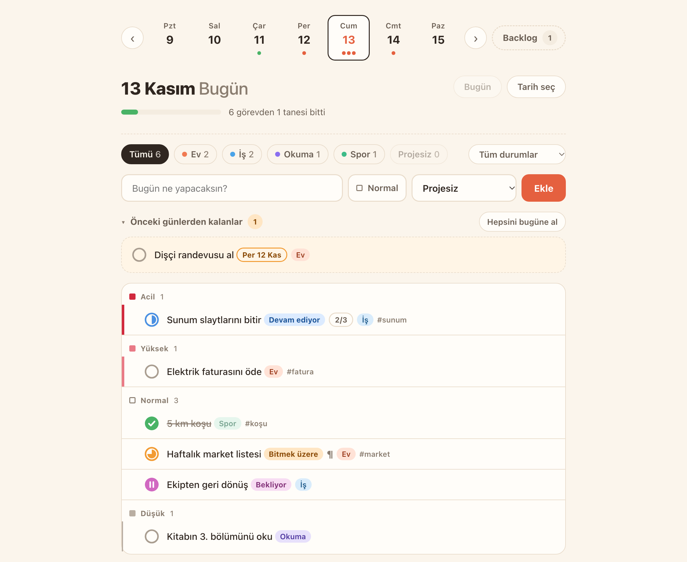

# Günlük

## What it does
Her günün kendi yapılacaklar listesi. Üstte günler arasında gezersin, altında projeye ya da duruma göre süzersin. Görevi tek satırda yazıp Enter'a basarsın, sürükleyerek sıralarsın, yuvarlak işarete tıklayıp durumunu seçersin: Başlamadı, Devam ediyor, Bitmek üzere, Bekliyor, Bitti. Bir göreve tıklayınca sağdan detay paneli açılır: proje, gün, serbest etiketler, kendi durumları olan alt görevler ve altında sayfanın kalanını kaplayan açıklama. Açıklama Notion gibi yazarken biçimlenir: # başlık, - madde, [] kutu, > alıntı, kod, link. Bitmeyen işi tek tıkla yarına ya da tarihsiz Backlog'a atarsın; önceki günlerden kalanlar bugünün sekmesinde ayrıca görünür. Yapay zekâ hiçbir şeyi değiştirmez; listeyi yalnızca sen yönetirsin.

## Screenshots

## What's new

### 4 · 2026-11-13
- İlk paylaşım: gün gün to-do listesi, aciliyet, Backlog, önceki günlerden kalanlar, yazarken biçimlenen açıklama.

### 3 · 2026-11-13
- Aciliyet: Acil, Yüksek, Normal, Düşük. Liste önce aciliyete, sonra senin sürükleme sırana göre dizilir; başka gruba sürüklenen görev o grubun aciliyetini alır.
- Hızlı eklemede aciliyet düğmesi ve kısayollar: başa !! acil, ! yüksek, ~ düşük.

### 2 · 2026-11-13
- Backlog: tarihsiz görevler için ayrı sekme; tek tıkla Backlog'a at / Bugüne al.
- Önceki günlerden kalanlar: bugünün sekmesinde bitmemiş eski görevler, hangi günden kaldığıyla; taşımayı sen yaparsın.

### 1 · 2026-11-12
- İlk sürüm: gün şeridi, renkli proje ve durum filtresi, hızlı ekleme, sürükle-bırak sıralama, renkli durumlar, yarına at.
- Detay paneli: yazarken biçimlenen açıklama (Markdown olarak saklanır), alt görevler, proje seçimi.
- Etiketler: görev başına serbest etiket, daha önce kullanılanlardan otomatik tamamlama.
